# Teaching a sim Franka to stack blocks with an LLM, then distilling it into a policy

*Isaac Sim 6.1 on the h200-training devspace, Oct 14–20, 2026*

Short version: we got Isaac Sim streaming on the H200 box, built a Franka pick-and-place scene that dumps everything to ROS 2 MCAP bags, had `gpt-6-astra` drive the arm through the LLM Gateway for 607 block-stacking episodes (it nailed every single one), and trained a small imitation policy on that data. The best policy stacks 67% of the time on layouts it's never seen. Then we built a web app for poking at all of it and running new episodes by hand.

Everything below is roughly in the order it happened, including the stuff that didn't work, because honestly the failures were the most useful part.

---

## 1. Getting Isaac Sim to stream at all

`./isaac-sim.streaming.sh` was dying on startup. It turned out to be four separate problems stacked on top of each other:

- **Mac Vulkan settings leaking in.** The fish config had `VK_ICD_FILENAMES` / `VK_DRIVER_FILES` pointing at a MoltenVK SDK that only exists on a Mac. That hid the NVIDIA driver completely. I wrapped that block in a macOS check, and the launch script now ignores Vulkan overrides that point at files that don't exist.
- **Every GPU showed up twice.** `/etc/vulkan/icd.d` has two NVIDIA ICD files that load the same driver, so Isaac saw 16 GPUs. The script now picks one.
- **Multi-GPU rendering crashed** with "device lost" about 30 s in. The script now pins rendering to GPU 0 by default (you can still override it).
- **`libXt.so.6` was missing.** I installed `libxt6` and added it to `~/setup.sh` along with `libglu1-mesa` and `vulkan-tools`.

After that it reached `app ready` in about 25 s. But there was a catch I only found out later: **H200s don't have NVENC** (no hardware video encoder), so the stream server was up but nobody could actually get video out of it. The fix is the streaming SDK's software encoder (OpenH264 2.4.1 + `STREAMSDK_USE_SOFTWARE_ENCODE=1`). `isaac-sim.streaming.sh` now turns that on automatically for GPUs without NVENC. It costs about 5 CPU cores while a viewer is connected.

Then we set up NVIDIA's web viewer (`isaac-sim.webviewer.sh`, port 8210). Headless Chrome on the box got 1080p at about 57 fps. Vite was rejecting the devspaces hostname, which was a one-liner in `vite.config.ts`. One thing to keep in mind: the video goes over UDP 47998, which the devspaces HTTPS proxy can't carry, so from a laptop you need:

```bash
coder port-forward h200-training --tcp 8210:8210,49100:49100 --udp 47998:47998
```

## 2. Recording a Franka pick-and-place to MCAP

Next up was a scripted Franka pick-and-place that records basically everything Isaac can publish into a ROS 2 bag (MCAP storage, zstd). The launcher is `tools/franka_recording/record_franka_bag.sh`.

What ends up in the bag:

- **60 Hz (physics rate):** joint states and commands, end-effector pose, cube pose/twist, an IMU on the hand, finger contact forces, and the pick-place phase.
- **Once:** TF for the whole arm, cameras and objects, `tf_static`, and the URDF.
- **Two cameras at 15 Hz, 640×480** (one fixed, one on the wrist): RGB, depth, point clouds, camera info, instance and semantic segmentation, and 2D/3D bounding boxes.

Getting the cameras to actually run at 15 Hz took a detour. The frame-skip setting didn't apply to depth and point clouds, so those ran at 60 Hz and the bag ballooned to 3–4 GB for 9 seconds. Switching to a per-camera tick rate fixed it (754 MB per run).

### The block that wouldn't stay stacked

You noticed the cube wasn't really stacking on the green target. That's because the green block had no collision at all, so the red cube was just sinking into it. The rule was "turn on collision for the blocks, don't touch the robot's motion", so:

1. Collision only: the cube now lands on top of the green block, but the arm's place goal is *inside* the block, so it stalls 4.5 cm short and times out.
2. You went with loosening the place tolerance so the gripper opens wherever the arm stops. That works, but it presses into the block first (contact force spikes to around 120 N vs about 5 N for a normal grasp).
3. Then on the retreat the open fingers swipe the cube off the block. You said keep it like that.

So the single-cube demo still doesn't end with a stack, and that's on purpose. If you ever want it to, the fix is raising `PLACE` z from 0.025 to 0.08.

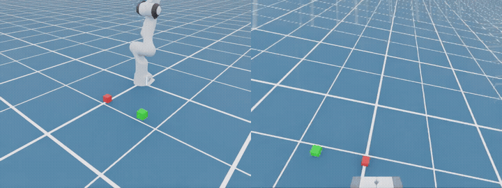

[mp4](assets/single_cube_pick_place.mp4). Left is the scene camera, right is the wrist camera. Watch the cube get knocked off at the end.

## 3. Letting the LLM drive

The obvious-in-hindsight design decision: **don't have the LLM output joint commands.** It takes 3–5 s per call and the arm wants commands at 60 Hz. Instead, the LLM picks one high-level action at a time, and RMPflow (Isaac's motion controller) plus the gripper controller carry it out. The sim is paused while we wait for the reply, so latency never shows up in the robot data.

The action set is tiny:

| action | args |
|---|---|
| `move_to` | x, y, z of the grasp point |
| `close_gripper` | none |
| `open_gripper` | none |
| `done` | none |

Every step, the model gets:

- the task ("stack green on blue")
- the measured gripper position, finger openings and all three block positions
- the history of what it already did and how each step went
- both camera images

It answers with strict-schema JSON: a sentence of reasoning plus the action. (Function calling doesn't work on `gpt-6-astra` with reasoning on, so it's `response_format: json_schema` instead.)

Each scene has red, green and blue 5 cm blocks dropped at random positions, plus one of the six "put X on Y" tasks. We ran one Isaac worker per GPU on GPUs 1–7 (GPU 0 was busy with your streaming session) for about 95 minutes, until the token expired.

**Results:**

- **607/607 episodes stacked successfully.** Median stacking error was 4.8 mm.
- Usually 8–9 LLM calls per episode.
- 5,286 calls total, median latency 3.5 s (p95 around 12 s).
- About 5.2M prompt tokens and 0.34M completion tokens.
- 133 GB of bags in `~/franka_llm_data/episodes/`. Each episode also gets an `episode.json` with every prompt, reply and result.

Here's what a typical run looks like. This is seed 100002, "green on blue", all 8 decisions:

| # | action | what Astra said |
|---|---|---|
| 1 | `move_to(0.486, -0.120, 0.200)` | The gripper is already open. Move directly above the green block at a safe height before descending to grasp it. |
| 2 | `move_to(0.486, -0.120, 0.025)` | The open gripper is above the green block. Descend to its center to prepare for grasping. |
| 3 | `close_gripper` | The open gripper is aligned with the green block and close enough to its center to grasp it. |
| 4 | `move_to(0.486, -0.120, 0.200)` | The finger positions indicate the green block is grasped. Lift it clear of the table. |
| 5 | `move_to(0.413, -0.226, 0.200)` | The green block is securely grasped and lifted. Move above the blue block at the current safe height. |
| 6 | `move_to(0.417, -0.226, 0.088)` | Lower it onto the blue block, compensating for the green block's measured offset from the grasp point. |
| 7 | `open_gripper` | The green block is centered over the blue block and only slightly above its stacking height. |
| 8 | `done` | The green block is resting on the blue block at z=0.075 m. The stacking task is complete. |

That took 7 seconds of sim time and 42 seconds of wall time, most of it spent waiting on the model. Step 6 is the interesting one. It noticed the block had shifted a few mm in the gripper and nudged the target to compensate, which is a big part of why the placements are so tight.

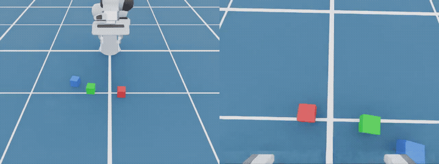

[mp4](assets/llm_seed100002.mp4)

## 4. Training a policy on the LLM's episodes

The point of all that data was to get rid of the LLM: train something fast that maps camera images and joint state straight to actions.

**Dataset.** `bags_to_dataset.py` resamples each bag to 15 Hz (the camera rate) and writes one npz per episode with:

- both camera images at 128×128
- joint positions and velocities, plus the commanded joints
- hand pose, block poses and the gripper command
- the LLM's current `move_to` waypoint at that moment

That's about 63k frames from 577 training episodes, with 30 held out.

**Model.** ACT-style: a ResNet-18 for each camera, plus tokens for the joints and the task (and optionally the true block positions), into a small transformer. It predicts the next **16** actions at once (about 1 s of motion), runs the first 8, then asks again. Each model takes around 12 minutes on one H200 (20k steps).

**Evaluation.** The policy replaces the LLM in the same sim, on random seeds that were never used during collection.

### What I tried, and how it went

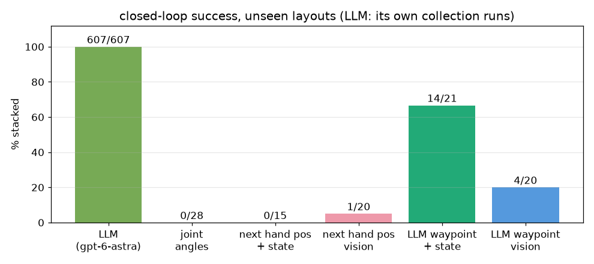

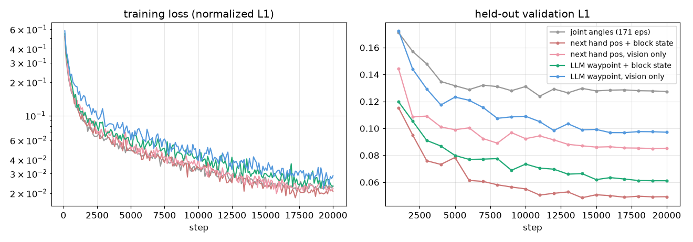

| policy predicts... | inputs | success |
|---|---|---|
| joint angles (early run, 171 episodes) | images + joints + task + block positions | 0/28 |
| next hand position | images + joints + task + block positions | 0/15 |
| next hand position | images + joints + task | 1/20 |
| **the LLM's current waypoint + gripper open/closed** | images + joints + task + block positions | **14/21 (67%)** |
| the LLM's current waypoint + gripper open/closed | images + joints + task | 4/20 (20%) |

Look at the validation curves next to the success chart. **The next-hand-position policy had the *lowest* validation error of anything and stacked zero blocks.** Validation loss was basically useless for predicting how these would do in the sim.

Here's why it failed. In the demos, the arm is always being pulled toward an LLM waypoint that's maybe 20 cm away, so "where the hand is 1/15 s later" is only a few mm ahead. The policy learns those small steps perfectly. But when you hand a point a few mm away to RMPflow as a *target*, it only moves part of the way there each tick. So the arm moves way slower than in the demos. Before long the images and joints look nothing like the training data, and it stalls short of the block. Joint targets fail the same way.

The fix was to predict **the same thing the LLM actually sent the controller**: the current waypoint and whether the gripper is open. RMPflow sees exactly what it saw during collection and reproduces the motion. That one change took it from 0% to 67%.

### Watching it work (and not work)

Same layout as the LLM clip above (seed 100002), but I asked for red on green this time. The state policy gets it on the first try with 4 mm of error:

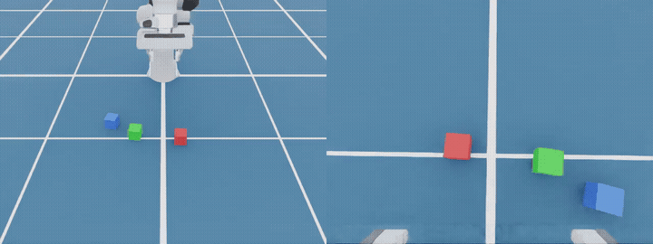

[mp4](assets/policy_state_seed100002_success.mp4). The GIF is sped up 2×.

A typical state-policy failure (seed 901000, red on green). It picks up the red block fine and carries it over, but lets go about 4 cm off-center. The block slides off, and then the policy just pokes around near the table and never re-grasps:

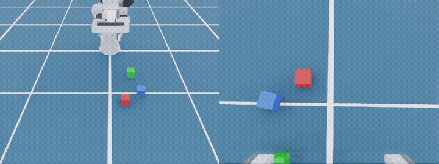

[mp4](assets/policy_state_seed901000_fail.mp4). Sped up 2×.

That's the classic imitation learning problem. Astra never failed, so the dataset has **zero recovery examples**. Once the policy drifts off the demo distribution, it has no idea what to do.

The vision-only policy does manage sometimes (seed 904000, blue on red):

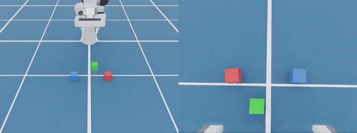

[mp4](assets/policy_vision_seed904000_success.mp4)

But more often it looks like this (seed 904002, green on blue). It heads to roughly the right side of the table, closes the gripper on empty air about 20 cm above the table, and then wanders around holding nothing:

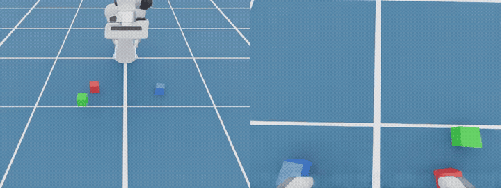

[mp4](assets/policy_vision_seed904002_fail.mp4)

My best guess is resolution. At 128×128, a 5 cm block in the scene camera is just a handful of pixels, so it can't really localize the blocks. The state policy gets their positions for free, and that's the whole 20% → 67% gap.

## 5. Franka LLM Lab: a viewer and run console

To actually get a feel for the data, I built a small web app in `tools/franka_lab/`. Run it with:

```bash
~/isaacsim/tools/franka_lab/run.sh --port 8240 --gpu 1
```

It's at https://8240--standard--h200-training--akashgarg.devspaces.rbx.com.

**Episodes tab.** Every LLM episode, every eval run and everything you run yourself, with filters for task, outcome, step count, error and latency. Picking one gives you:

- the camera video, synced to everything else on the page
- a timeline bar of the LLM's steps (click to seek)
- a 3D plot of the gripper path (green while open, orange while closed) with the LLM's waypoints and the blocks moving along with the video
- a plot of gripper height and finger opening
- a card for each decision with the model's reasoning, latency, token counts and the full prompt it saw

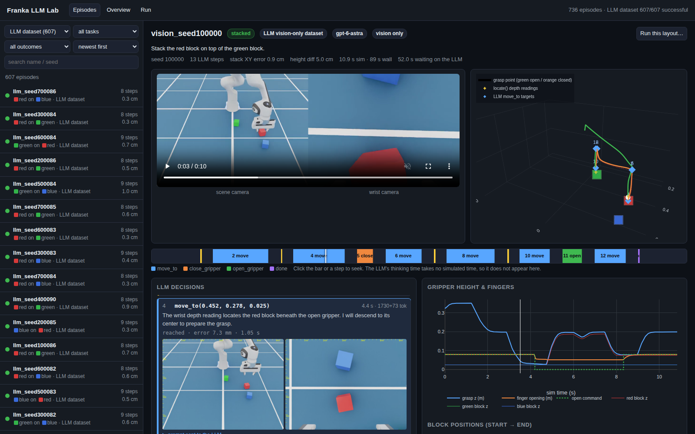

**Overview tab.** Dataset-wide charts: success by source, steps per episode, a top-down map of every grasp and release, latency, release heights and stacking error.

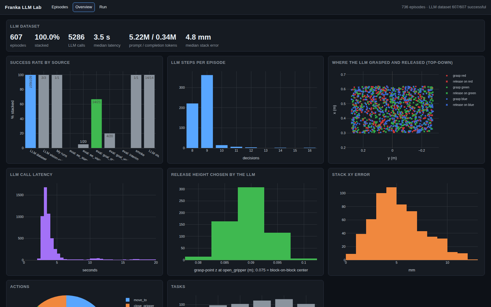

**Run tab.** Pick the LLM or any trained checkpoint, a task, a seed (dataset seeds reproduce that exact layout, so you can race the LLM and a policy on the same scene) and optionally a free-text instruction. Then watch both cameras and the decisions live. The sim worker stays warm on GPU 1, so runs start right away. When a run finishes, it shows up in the Episodes tab like everything else.

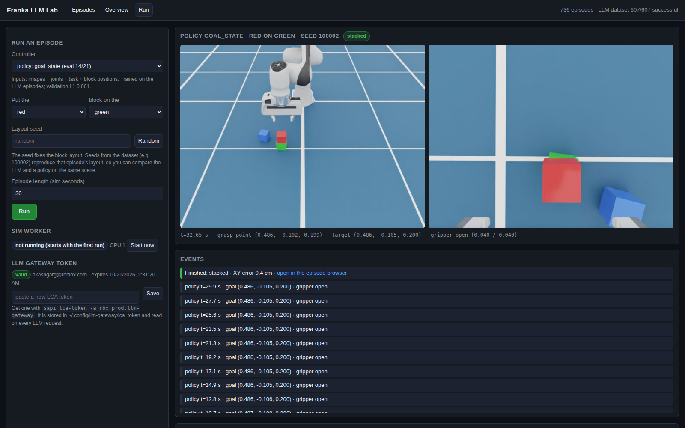

LLM runs need a valid LCA token. The one you gave me expired Oct 20 at 01:54 UTC, and you can paste a new one right in the Run tab. Policy runs don't need it.

## 6. Two questions that came up

**"Why a 16-class action space instead of just move_to and open/close?"**

It isn't 16 classes. 16 is how many steps ahead the policy predicts each time. Each step is 4 numbers: waypoint x, y, z and gripper open/closed. That *is* move_to plus open/close, just written out 15 times a second instead of once per primitive. Predicting a chunk of the future rather than one step is the standard ACT trick. It smooths things out, cuts down on compounding error, and lets the model learn *when* to close the gripper without a separate "is the primitive done?" signal.

A policy that literally copies the LLM's format (pick 1 of 4 actions plus xyz, then let RMPflow run it) is a totally reasonable thing to try. The downsides are that you only get about 5.3k decisions to learn from instead of about 63k frames, and it can't react mid-motion.

**"Why not predict hand position further ahead and let IK smooth it out?"**

You're right that the controller smooths things, and that's exactly why the waypoint version works. The catch is that RMPflow *chases a point*. It doesn't follow a path with timing. Feed it a sequence of close-together hand positions and it lags behind every one of them, which is the failure from section 4. Predicting where the hand should be 0.5–1 s out, and sending *that* as the target, is basically the waypoint action again.

Longer chunks (32 or 48 instead of 16) are worth trying, but they come with tradeoffs. The policy reacts more slowly unless you re-query just as often, and further out it has to average over more possible futures, so the predictions get blurrier. I haven't run that experiment yet.

## 7. What I'd do next

- **Get recovery data.** Run the policy, and when it messes up, hand control to the LLM to fix it, then train on those fixes (DAgger-style). The 901000 failure is exactly the case this would help.
- **Bigger or cropped images** for the vision-only policy, so it can actually see the blocks.
- **Chunk length sweep** (16 / 32 / 48) on the waypoint policy, and a version that predicts the hand position 0.5–1 s ahead.
- **Bigger eval sets.** 20-ish episodes per policy gives really wide error bars. 14/21 is consistent with anything from about 45% to 83%.

## Where everything lives

| what | where |
|---|---|
| streaming / web viewer launchers | `~/isaacsim/isaac-sim.streaming.sh`, `isaac-sim.webviewer.sh`, `tools/web-viewer/` |
| single-cube recorder | `~/isaacsim/tools/franka_recording/record_franka_bag.sh`, `franka_pick_place_ros2.py` |
| LLM episodes, collection, dataset, training, eval | `tools/franka_recording/franka_llm_episodes.py`, `collect_llm_episodes.sh`, `bags_to_dataset.py`, `train_policy.py`, `eval_policy.sh` |
| lab app | `~/isaacsim/tools/franka_lab/` |
| misc scripts saved from /tmp | `~/isaacsim/tools/dev_scripts/` |
| LLM episodes (133 GB) | `~/franka_llm_data/episodes/` |
| training dataset | `~/franka_llm_data/dataset/` |
| checkpoints | `~/franka_llm_data/runs/{goal_state,goal_vision,ee_state,ee_vision,interim}/` |
| eval results | `~/franka_llm_data/eval_*/` |
| your runs from the lab | `~/franka_llm_data/lab/runs/` |

### Gotchas worth remembering

- ROS 2 Jazzy needs `bash -c 'source /opt/ros/jazzy/setup.bash; python3.12 ...'`. Plain `python3` on this image is 3.10 and zsh can't source the setup file.
- Give each sim worker its own `ROS_DOMAIN_ID` and set `ROS_AUTOMATIC_DISCOVERY_RANGE=LOCALHOST`, or the workers' topics get mixed together.
- Never `pkill -f` a pattern that also shows up in your own command line. I killed my own shell twice that way.
- `libxt6` and the ROS install don't survive a container rebuild unless they're in `~/setup.sh` (libxt6 is, ROS isn't yet).
