# Teaching a Franka to stack blocks from LLM demos

Sim is Isaac Sim 6.1: a Franka arm, three coloured cubes, and one instruction per episode ("stack the red block on the green block"). The idea was to have an LLM (Astra, `gpt-6-astra`, through the LLM Gateway) do the task, record everything as ROS 2 bags, and then train a small policy on those recordings to see how much of the LLM's behaviour it picks up.

Short version: the LLM is basically perfect at this, even when it can only see camera images. The policy trained on its demos is not. The best one, trained on vision-only data, stacks the right block about 40% of the time (29 of 70 held-out layouts). Most of what's left is the policy carrying the block to the wrong destination cube.

## 1. Getting the LLM to drive the robot

Astra never touches joints. Each step it gets a prompt, picks one high-level action, and RMPflow does the actual motion. The action set is tiny:

- `move_to(x, y, z)` for the gripper
- `open_gripper` and `close_gripper`
- `done`
- `locate(camera, u, v)`, vision mode only (more on that below)

The first version handed the LLM the full world state, meaning exact xyz for every block. It went 607 for 607, at about 9 steps and a minute of wall time per episode. Every episode is a ROS 2 MCAP bag with both cameras (scene and wrist, 640x480), joint states, gripper and block poses. The LLM's reasoning for each step goes into `episode.json`.

## 2. Taking the world state away

Next, the LLM had to work from pixels only: no block poses, just the two camera images plus the robot's own proprioception (where the gripper is, how open the fingers are). Asking an LLM to eyeball metric 3D coordinates from a photo doesn't really work, so we gave it a `locate(camera, u, v)` tool. It clicks a pixel, we read the depth image there, and we deproject it into a world xyz. A sanity check that projects the true block tops into the image comes back within 2.5 mm, so the tool itself is solid. Pixel rulers drawn on the edges of the images help the LLM pick coordinates.

This is what Astra sees at the start of an episode (scene camera on the left, wrist camera on the right):

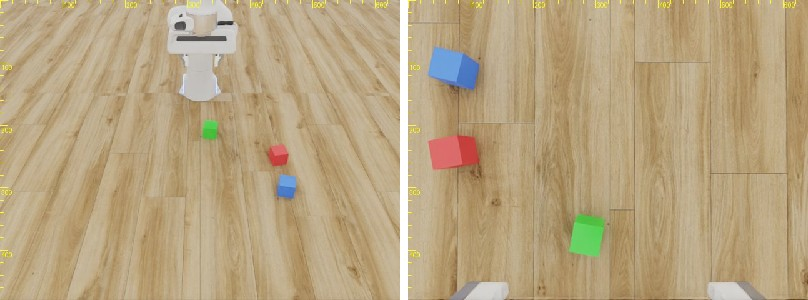

And right before it places the red block on the green one. Note how the held block covers most of the wrist view:

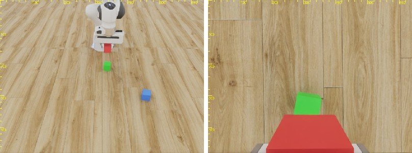

A typical episode goes like this: locate the block in the scene view, move above it, re-locate in the wrist view to tighten things up, descend, grab, lift, then the same for the target block, release, back off, done. That's about 13 steps.

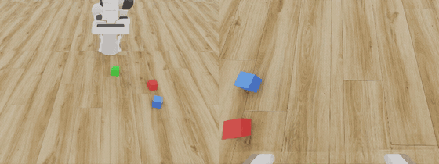

([mp4](assets/llm_vision_wood_demo.mp4); the video skips the time the LLM spends thinking, which is roughly 4 s per step in reality.)

## 3. Swapping the grid table for wood

The default ground is a blue grid, which is a bit of a cheat for calibration. So we laid a wood-texture table over it, purely visual (collision still comes from the ground plane), and re-ran the whole vision-only collection on it.

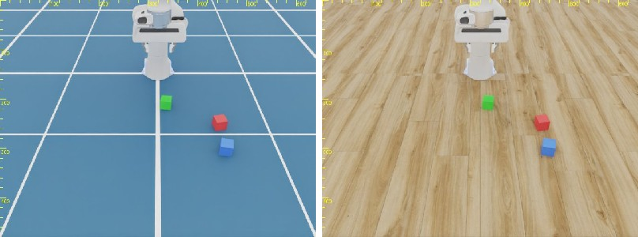

The LLM didn't care at all: **630/630 successes** on wood, about 13 steps and 90 s per episode. That came to around 315 GB of bags.

## 4. Training a policy on the LLM data

The policy is a small ACT-style model:

- Inputs: two ResNet18 image encoders (scene and wrist), plus joint positions and a task token, and optionally block positions.
- A transformer predicts a chunk of the next 16 actions; at run time we execute the first 8 of each chunk at 15 Hz.
- Each action is "where the gripper should be heading, and is it open". We tried predicting the raw end-effector pose first, but RMPflow lags behind its target, so those demos taught the policy to lag too. Goal-style actions fixed that (in early small evals, goal actions got 14/21 against 0/15 for raw poses).

Every eval runs the policy closed-loop in the sim on the same **70 held-out layouts**, with 30 sim-seconds per episode. A success means the right block ends up on the right block.

The first comparison asked whether a policy trained on vision-only demos can match one that's given block positions directly:

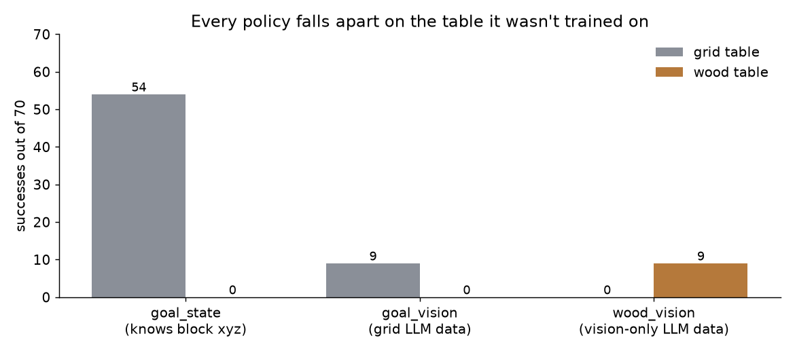

- With block positions handed in, the policy does well on the grid table (54/70).
- Using only images, policies trained on either dataset sit around 9/70.
- Every policy scores **0** on the table it wasn't trained on. Even the one that knows the block positions falls apart, because its image features change completely when the table looks different. Lesson learned: these policies don't generalise across visual changes at all without varied training data.

## 5. Image resolution

The 9/70 vision policy was looking at 128x128 images, with the 640x480 scene view squashed into a square. That's not much to find a 5 cm cube with, and real RealSense cameras happily do 640x480 or more, so there was no hardware reason to stay that small. We re-made the dataset at a few sizes and trained each run for 20k steps.

From left to right below: 128x128, 256x192, and full 640x480 (cropped around the blocks and blown up so you can see the pixels):

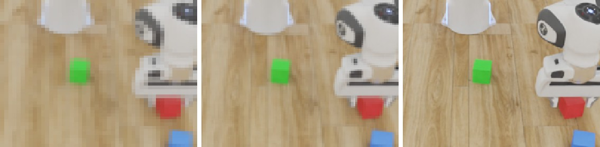

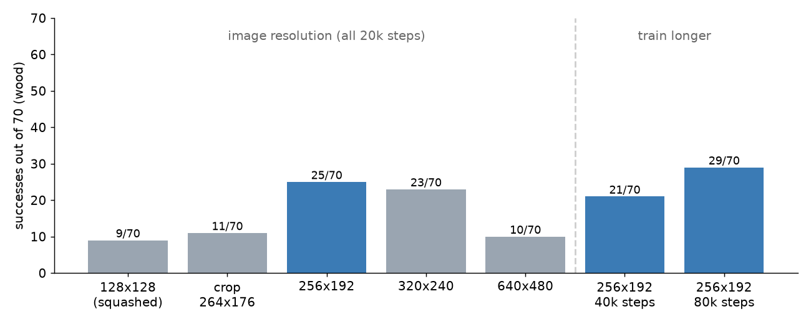

- **256x192 was the sweet spot:** 9 → 25/70.
- 320x240 came out about the same (23/70).
- Full res got *worse* (10/70). At 640x480 there are about 600 image tokens per step against one task token, and the policy mostly forgot which block it was told to pick (it picked the wrong block 41 times). It was also undertrained at 20k steps; full-res runs are slow.
- Cropping the scene view down to just the table (11/70) hurt too. Our guess, not verified, is that it throws away context like where the arm is.

## 6. Training 256x192 for longer

Last experiment: same data and model, trained for 40k and 80k steps instead of 20k.

| Run | Success on wood | Best val L1 |
|---|---|---|
| 20k steps | 25/70 | 0.062 |
| 40k steps | 21/70 | 0.063 |
| 80k steps | **29/70** | 0.062 |

One caveat: we keep the checkpoint with the best validation loss, so the "40k" and "80k" policies are really the step 35k and step 52k snapshots. Validation L1 stalls at about 0.062 from around 20k steps onward. With 70 episodes the noise is about ±4 successes, so 21, 25 and 29 aren't clearly different. Longer training gives at best a small bump.

## Where it fails

We sorted every failed episode by what happened to the block that was supposed to be moved:

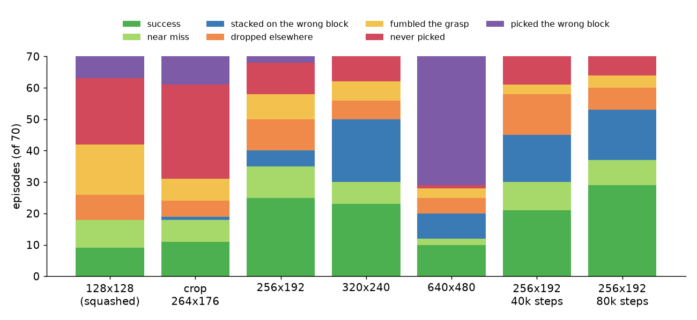

Reading left to right, things move up the pipeline. At low res the policy often can't even find or grab the block (red and yellow). At 256x192 and up, grabbing mostly works. The 80k policy only missed the grasp entirely 6 times, and it never grabbed the wrong block. The biggest bucket now is **stacking on the wrong block** (blue, 16/70): it picks up the correct block and then sets it down on the third cube instead of the target.

Here's a success from the 80k policy (red on blue). Scene camera is on the left, wrist on the right; 2× speed:

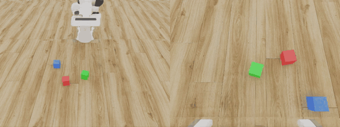

And the typical failure. The task was green on *blue*, but it grabs green fine and then stacks it on red:

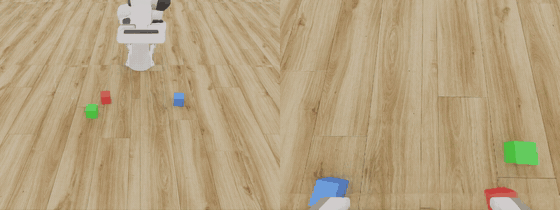

A near miss: green was supposed to go on red, but it put green down on the table about 6 cm away:

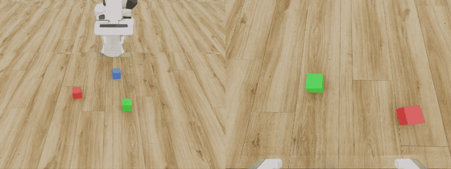

(mp4s: [success](assets/policy80k_seed901002.mp4), [wrong block](assets/policy80k_seed904002.mp4), [near miss](assets/policy80k_seed904001.mp4). These six replays matched the original eval outcomes exactly, so the eval is deterministic.)

## What we'd try next

The remaining problem is mostly "where to put it", not "how to grab it", so more training steps or more pixels probably won't help much. Things worth trying:

- **Make the task harder to ignore.** Right now the instruction is a single token next to a few hundred image tokens. Separate tokens for "pick colour" and "place colour", or FiLM-conditioning the image encoders on the task, might help.
- **Help it see the target while carrying.** Once a block is in the gripper, the wrist camera mostly sees that block (see the second LLM image above). The policy then has to find the target from the scene camera alone. Options are a second wrist camera, or giving it a frame from before the grasp.
- **More varied data.** Different tables, lighting and camera jitter. Every policy here dropped to 0% on a new table texture, so this matters before anything gets near real hardware.

## Where stuff lives

| What | Path |
|---|---|
| LLM episodes: full-state / vision on grid / vision on wood | `~/franka_llm_data/episodes`, `vision/grid_episodes`, `vision/wood_episodes` |
| Datasets (npz) | `~/franka_llm_data/dataset_wood_res256` etc. |
| Checkpoints | `~/franka_llm_data/runs/<name>/policy.pt` |
| Eval results | `~/franka_llm_data/eval_<name>/summary.json` |
| Code | `~/isaacsim/tools/franka_recording/` (`franka_llm_episodes.py`, `bags_to_dataset.py`, `train_policy.py`, `eval_policy.sh`) |
| Episode browser / replay / live runs | Franka LLM Lab on port 8240 (screenshot below) |
| Figures for this report | `make_figures.py` in this folder |

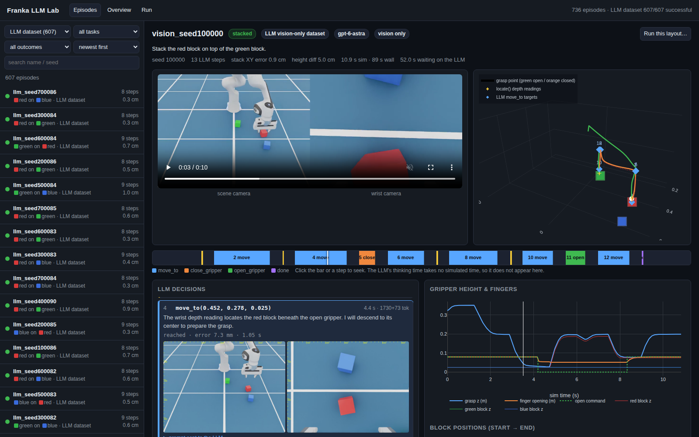
